# Wordkeep

**CP3406 Assessment 3 – Education App** · Kotlin · Jetpack Compose · Material 3 · Room · Hilt

Repository: [zazylfs-sys/CP3406-Wordkeep](https://github.com/zazylfs-sys/CP3406-Wordkeep)

Wordkeep helps **university students, especially those studying in English as an additional
language, learn the academic vocabulary their lectures and readings use**. Learners look up words
in a real dictionary, save the ones they need, and practise them in short, finite sessions
scheduled by the SM-2 spaced-repetition algorithm. It ships with an optional starter list:
the 60 headwords of the Academic Word List, sublist 1 (Coxhead, 2000).

The app follows the commitments from my Assessment 2 ethics presentation (location privacy and
accessibility): collect only what learning needs, explain before asking, and be accessible by
default.

| Today (landing) | Flashcard | Meaning match | Listen & spell |
|---|---|---|---|
| 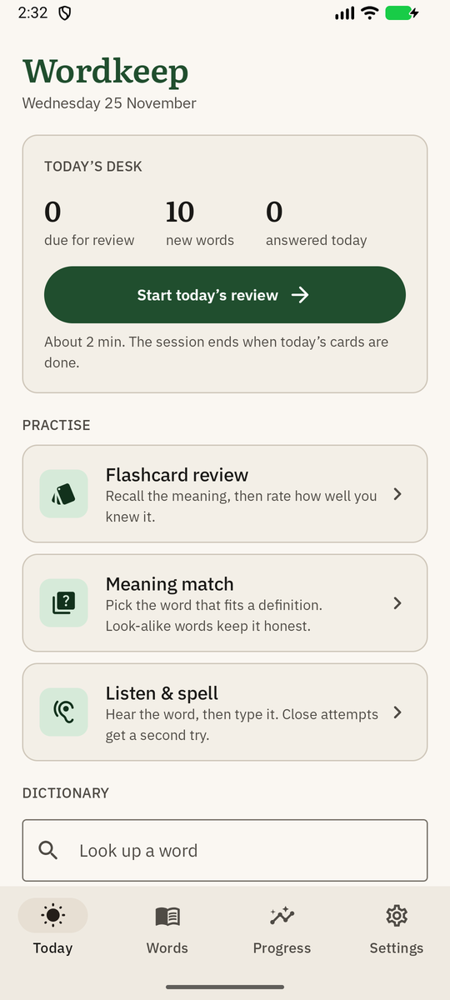 | 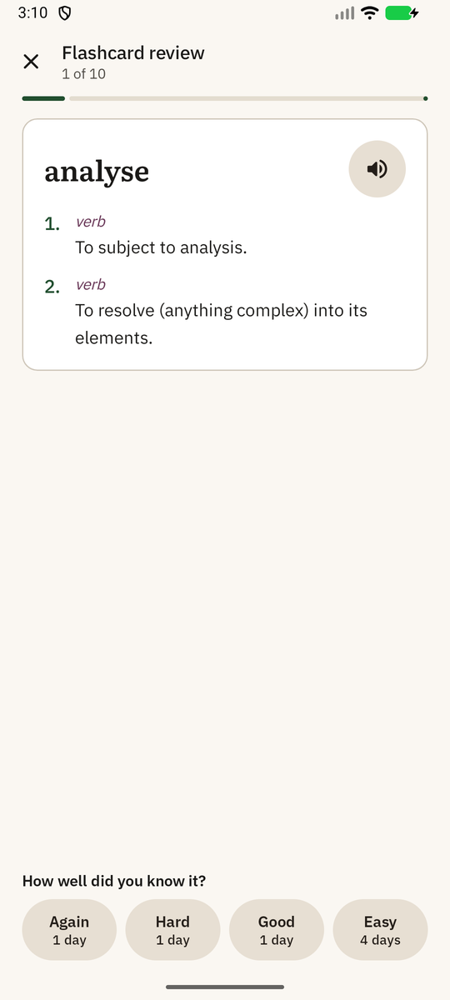 | 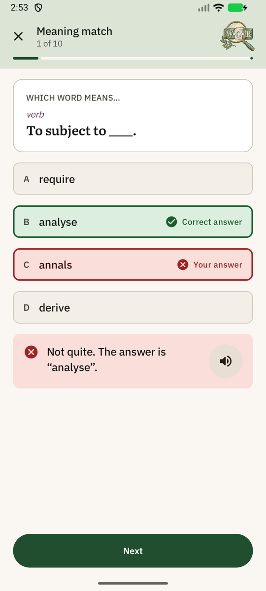 | 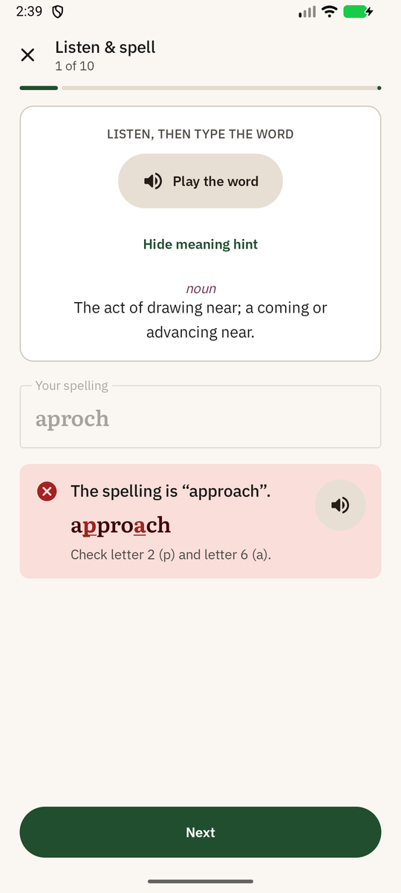 |

| Progress | Words | Settings | Your data |
|---|---|---|---|
| 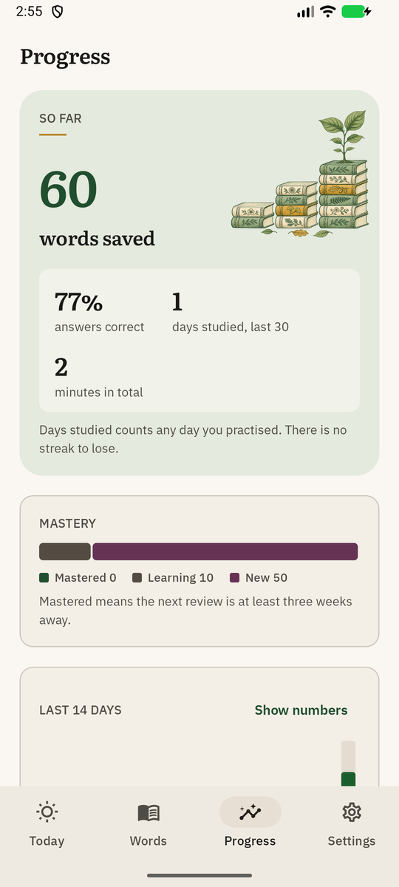 | 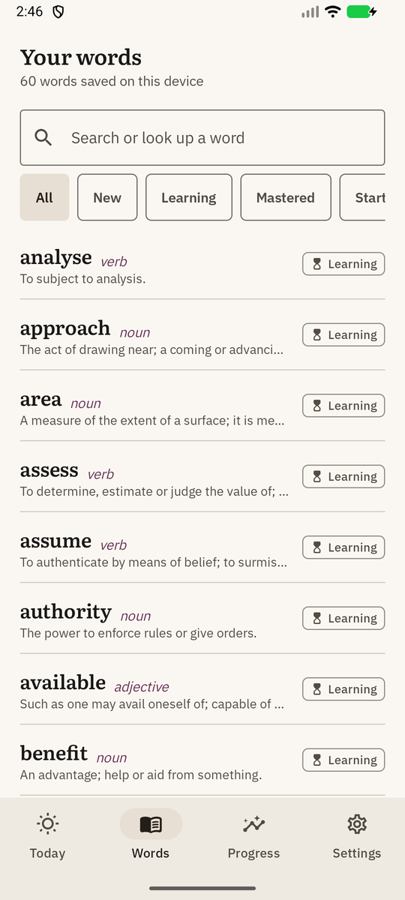 | 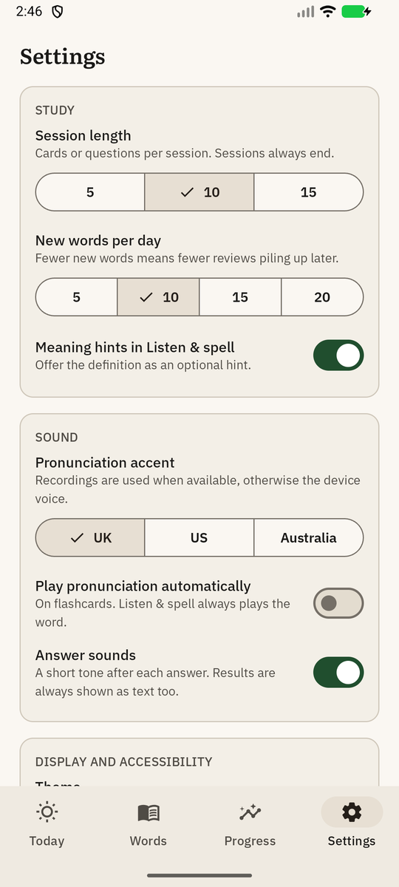 | 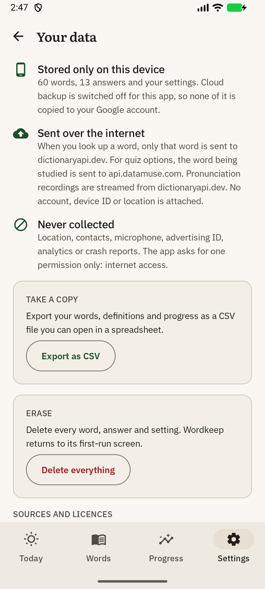 |

| First run | Spelling: near miss | Session summary | Today, dark theme |
|---|---|---|---|
| 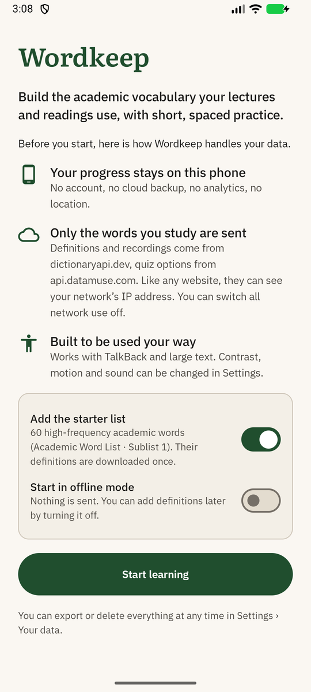 | 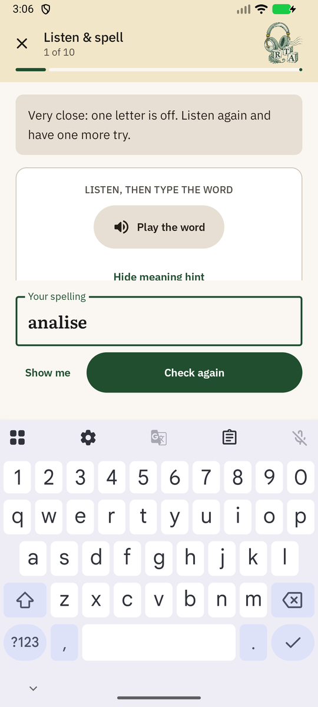 | 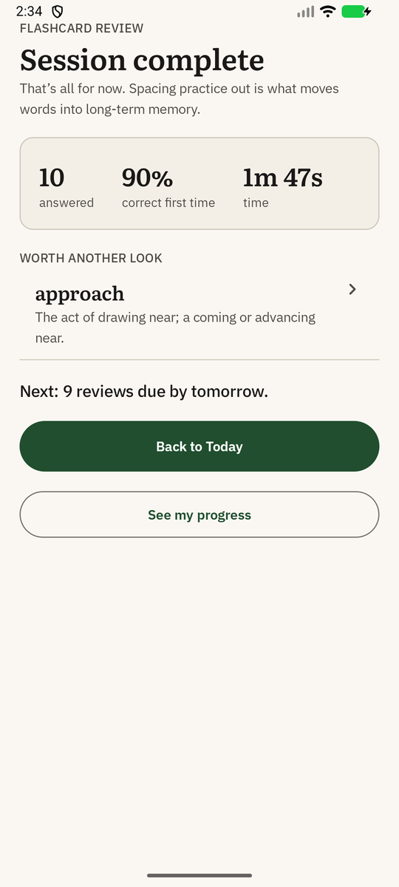 | 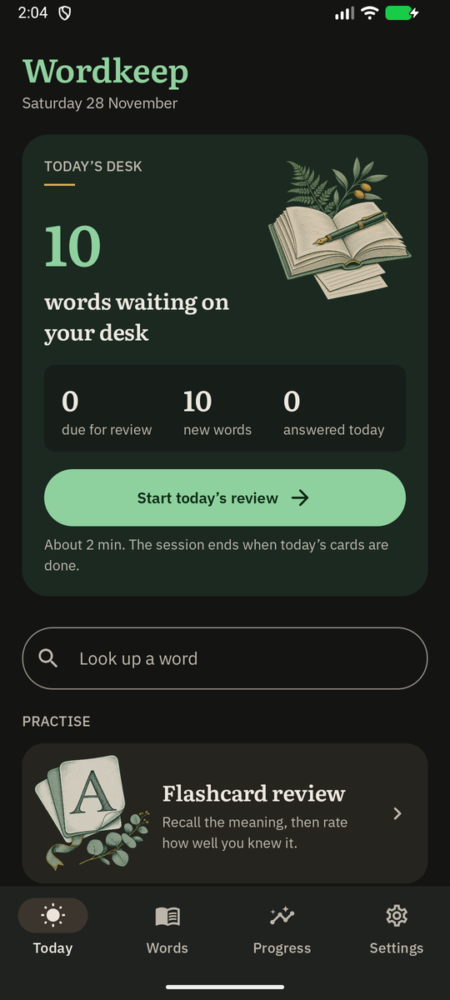 |

Landscape and tablets use a navigation rail and two columns:

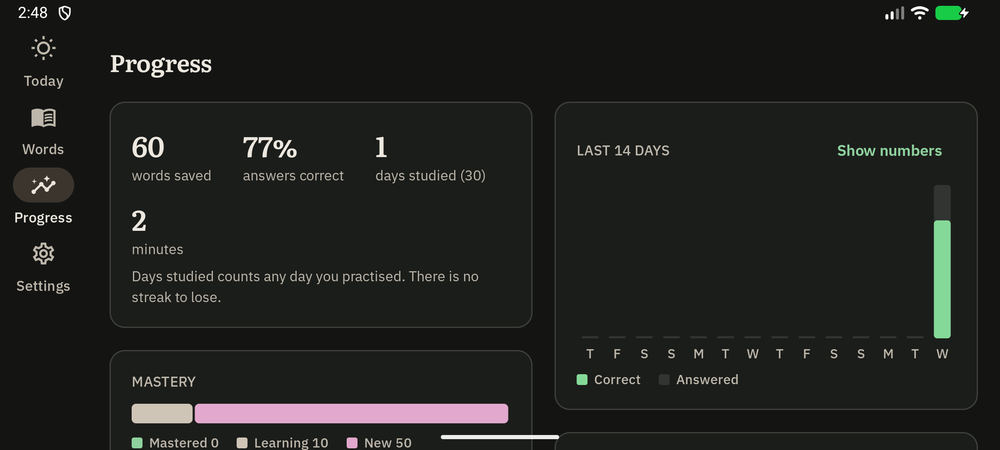

*Screenshots are from a Pixel-size emulator (API 36) using live dictionary data on 25 Nov 2026.*

---

## Core features

### Screens

| Screen | What it does |
|---|---|
| **First run: "How Wordkeep handles your data"** | Explains, before anything is sent, which two services are contacted and what never leaves the phone. The learner chooses whether to add the starter list and whether to start in offline mode. |
| **Today (landing page)** | Today's desk: reviews due, new words available (capped per day), answers today. One button starts the day's review. Shortcuts to the three activities (disabled with a reason when they can't run), a dictionary search, download and offline notices. |
| **Activity: Flashcard review** | Recall the meaning, flip the card (3D flip, or a fade with reduced motion), grade *Again / Hard / Good / Easy*. Each button shows the interval it will schedule. Cards graded *Again* come back once at the end of the session as practice. |
| **Activity: Meaning match** | Pick the word that fits a definition. The definition has the answer masked ("To subject to ____"). Distractors are look-alike words from the Datamuse API plus words from the learner's own deck, so recognising the word's shape is not enough. |
| **Activity: Listen & spell** | Hear the word (human recording, or the device voice), type it. A near miss gets one more try; afterwards the missed letters are underlined and also listed in text ("Check letter 7 (n)"). British and American spellings are both accepted. |
| **Session summary** | Answered, correct first time, time taken, words worth another look. It ends with "That's all for now" rather than offering another round. |
| **Words (library)** | Search saved words, filter by New / Learning / Mastered / Starter list, or look a new word up in the dictionary. |
| **Dictionary look-up** | Shows the entry (IPA, recording, numbered senses, examples) *before* saving, with source attribution. |
| **Word detail** | Senses, a personal "memory hook" note (shown on the flashcard back), SM-2 progress, reset progress, delete word. |
| **Progress (statistics)** | Mastery bar, 14-day activity chart, 7-day review forecast, accuracy by activity, words that need care. Every chart has a "Show numbers" table. "Days studied (30)" replaces a streak. |
| **Settings** | Session length, new words per day, spelling hints, accent (UK / US / Australia), auto-play, answer sounds, theme, text size, high contrast, reduce motion, offline mode. |
| **Your data** | Plain-language account of what is stored and sent, CSV export (system file picker, no storage permission) and "Delete everything". |

### Ethics by design (from Assessment 2)

| A2 commitment | How Wordkeep implements it |
|---|---|
| Collect only what learning needs, no location | The manifest requests **only `INTERNET`**. No account, analytics, advertising ID or crash reporting. Only the word being looked up is sent. Requests carry a generic User-Agent. |
| Keep data where it is safe | Learning data lives in Room on the device. `allowBackup="false"` and data-extraction rules keep it out of cloud backup and device transfer. |
| Explain before asking for anything | The first-run screen names `dictionaryapi.dev` and `api.datamuse.com` before any request. The look-up row says "Sends only this word to dictionaryapi.dev". |
| Learner control | Offline mode stops all network use, including streamed audio, and offline speech uses only on-device voices. CSV export. Delete one word (with its answers) or everything. |
| Accessible by default | Headings and merged semantics, labelled icon buttons, polite live regions for quiz feedback, 48dp+ touch targets, WCAG AA contrast (light, dark and high-contrast palettes), app text size on top of the system font scale, reduced motion (app setting or the system "Remove animations"), colour never the only signal (icons and words on every result), chart data tables, IPA labelled for screen readers. Automated ATF checks run in the instrumented tests. |
| Humane persuasive design | Sessions always end, new words are capped per day, there are no streaks, badges or notifications, and extra practice never pushes a word's schedule further away. |
| Honesty | Definitions are attributed (Wiktionary, CC BY-SA 3.0). The scheduler's behaviour is described in the app ("Mastered means the next review is at least three weeks away"). |
| Track ethical debt | Open items are listed in [Ethical debt](#ethical-debt) and as GitHub issues labelled `ethical-debt`. |

---

## Implementation

### Architecture

```
MainActivity ── WordkeepApp (NavigationSuiteScaffold: bar on phones, rail ≥ 600dp)
                     └── NavHost (type-safe routes, nested graphs)
 ui/<feature>/  Screen (stateless composable) + Route (collects state) + ViewModel (@HiltViewModel)
                     │ StateFlow<UiState>                     ▲ events
                     ▼                                         │
 data/repository  WordRepository · StudyRepository · StatsRepository · PrivacyRepository · SettingsRepository
                     │                         │                         │
            Room (WordkeepDatabase)     Retrofit APIs            DataStore (preferences)
 domain/          pure Kotlin: Sm2Scheduler, SessionPlanner, MeaningQuizBuilder,
                  SpellingJudge, StatsCalculator, StarterPack (no Android imports)
 di/              Hilt modules: App (Clock, Random, dispatchers, app scope, DataStore),
                  Database, Network, Data (@Binds interfaces → implementations)
```

- **MVVM + Repository + Hilt.** ViewModels depend only on repository interfaces. Hilt `@Binds` supplies the Room/Retrofit implementations, and tests swap in fakes (`@TestInstallIn` in instrumented tests).
- **Unidirectional data flow.** Each screen is a stateless composable (`HomeScreen(state, callbacks…)`) wrapped by a small route that collects `StateFlow`s with `collectAsStateWithLifecycle`. That keeps every screen previewable and testable without a ViewModel.
- **Testable time and randomness.** `java.time.Clock` and `kotlin.random.Random` are injected, so scheduling and quiz shuffling are deterministic in tests.
- **Work that must finish.** Saving answers and "Delete everything" run in an injected application scope, so leaving the screen cannot cancel them halfway.
- **Assisted injection.** `SessionViewModel` receives its `StudyMode` from the route through `@AssistedInject`, so it can be constructed directly in JVM tests.

### Navigation (Navigation Compose 2.9, type-safe)

- `@Serializable` route classes with typed arguments: `WordDetailRoute(wordId: Long)`, `SessionRoute(mode: StudyMode)`, `SummaryRoute(…, missedWordIds: LongArray)`.
- **Nested graphs**: `WordsGraph` (library → look-up → word detail) and `SettingsGraph` (settings → your data).
- **Tabs keep their own back stacks** (`saveState` / `restoreState`). Today is the root, so selecting it pops back rather than restoring a screen that was just left.
- **Back-stack hygiene**: a finished session is replaced by its summary (`popUpTo<SessionRoute> { inclusive = true }`), so Back from the summary goes home. A saved look-up is replaced by the word page. "Delete everything" clears every saved tab stack and returns to the first-run screen.
- **Conditional start destination**: first run vs Today, decided while the splash screen is held on screen.
- **Deep link**: `wordkeep://lookup/<word>` opens the dictionary on that word. Try `adb shell am start -d "wordkeep://lookup/hypothesis"`. Toolbars use `navigateUp()`, so Up works even when the deep link is the only screen.
- **Immersive sessions**: the navigation bar is hidden in sessions, and Back asks before ending one ("answers already given are saved").

### Room database (schema v2, with migration)

| Table | Purpose |
|---|---|
| `words` | Saved word, IPA, audio URLs and spelling variants (JSON lists via a `TypeConverter`), fetch state, learner's `note` (added in v2) |
| `senses` | Numbered definitions (FK → words, cascade delete) |
| `cards` | SM-2 state per word: repetitions, interval, ease, due day (epoch day), lapses, introduced day |
| `review_log` | Every answer: mode, grade, correct, time, response time. Statistics are computed from this table |
| `look_alikes` | Cached Datamuse distractors, so quizzes work offline (added in v2) |

- **Relations**: `WordWithDetails` loads a word with its senses and card via `@Relation` in one `@Transaction`.
- **Observable queries**: the UI observes `Flow`s from Room, so a saved answer updates Today, Progress and the library automatically.
- **Aggregates in SQL**: answers per day (`GROUP BY answered_day`), accuracy per activity, and the "hardest words" ranking (`JOIN` + `HAVING` + accuracy ordering).
- **Migration**: version 1 → 2 is an `AutoMigration`. Exported schemas are in `app/schemas/`, and `MigrationTest` rebuilds a v1 database with data and checks it survives the upgrade.
- **Narrow updates**: downloads update only dictionary columns, so they can never overwrite a learner's note. A word deleted mid-download is not recreated.
- Settings use **Preferences DataStore**, because small key-value data doesn't need a table.

### Internet APIs (Retrofit + kotlinx.serialization + OkHttp)

| API | Used for | Notes |
|---|---|---|
| [Free Dictionary API](https://dictionaryapi.dev) `GET /api/v2/entries/en/{word}` | Definitions, examples, IPA, human pronunciation recordings, spelling variants | No key. HTTP 404 means "not in the dictionary". Answers HTTP 429 after short bursts, so Wordkeep waits for the server's `Retry-After` and continues. |
| [Datamuse API](https://www.datamuse.com/api/) `GET /words?sp=…` and `?sl=…` | Look-alike and sound-alike words used as quiz distractors | Filtered so a distractor is never the answer or one of its inflections. Cached in Room. |

- **Offline first.** Room is the source of truth. The network only fills it, and every saved word works offline.
- **Graceful failure.** `LookupResult` distinguishes found / not found / offline mode / no connection / server error, and each has its own message and action.
- **Starter list download.** Runs in parallel batches of four, saves each word as it arrives, stops at the first connection problem, and resumes next time.
- `DictionaryMapper` cleans the Wiktionary-derived data: it merges entries, skips broken phonetics such as `/-əsəs/`, spreads senses across parts of speech, and caps the number of senses so flashcards stay readable.

### Learning logic (domain/)

- **SM-2** (Wozniak, 1990). Intervals are 1 day, 6 days, then interval × ease factor, rounded up. The ease factor floor is 1.3. One documented addition: *Easy* on a first review schedules 4 days ahead.
- **Session planning.** Due reviews come first (most overdue, then hardest), then new words up to the daily cap.
- **Scheduling rule.** Flashcard grades reschedule. Quiz and spelling answers reschedule only words that are due, so extra practice is logged but never distorts the schedule.
- **Spelling judge.** Levenshtein distance with an alignment back-trace. That produces the per-letter feedback and the "near miss" rule (≤ 1 edit for words of up to 4 letters, ≤ 2 for longer words).

### Compose and Material 3

- Custom "print lexicon" theme: Literata (serif headwords) and IBM Plex Sans (UI, with full IPA coverage), both bundled under the SIL OFL. It has light, dark and high-contrast colour schemes. Dynamic colour is off on purpose, so semantic colours keep their tested contrast.
- Components used: `NavigationSuiteScaffold`, `SingleChoiceSegmentedButtonRow`, `FilterChip`, `TopAppBar`, `AlertDialog`, `Snackbar`, `LinearProgressIndicator`. Charts are drawn on a `Canvas`.
- Animation: `graphicsLayer` card flip, `AnimatedContent` between questions, `AnimatedVisibility` for feedback, an animated chart entry and a pulsing play icon. All of them fall back to fades or static states with reduced motion.
- **Responsive**: a navigation rail on wide screens, two-column Today and Progress layouts, content width capped on tablets, the grade buttons switch to a 2 × 2 grid at large font scales, and scrollable bodies keep action buttons visible.

---

## Testing

| Suite | Type | What it covers |
|---|---|---|
| `Sm2SchedulerTest`, `SessionPlannerTest`, `MeaningQuizBuilderTest`, `SpellingJudgeTest`, `StatsCalculatorTest` | JVM | Published SM-2 values and ease floor, planning order and daily caps, fair distractors and masking, edit distance and letter diff, statistics edge cases |
| `DictionaryMapperTest` | JVM | Parses **real API responses** saved in `app/src/test/resources/dictionary/` |
| `OfflineFirstWordRepositoryTest` | JVM | Real Retrofit against `MockWebServer` + in-memory DAO fakes: 200/404/disconnect/429 with Retry-After, offline mode sends nothing, interrupted downloads, notes never overwritten, look-alike caching |
| `SessionViewModelTest`, `DescribeDiffTest` | JVM | Session state machine: repeats, first-time-correct summary, due-only rescheduling, spelling retry, no auto-play in Meaning match, spoken spelling feedback |
| `WordDaoTest` | Instrumented | Relations, cascade delete, due counts, aggregate SQL, reset, clear all |
| `MigrationTest` | Instrumented | v1 → v2 upgrade keeps words and progress |
| `SessionScreenTest`, `ScreensTest` | Instrumented (Compose) | Flashcard / quiz / spelling UI, labels, 48dp grade buttons, live-region feedback, Home, Settings, chart tables |
| `AccessibilityChecksTest` | Instrumented (Compose + ATF) | Google Accessibility Test Framework on every main screen in light and dark themes |
| `AppNavigationTest` | Instrumented (Hilt end-to-end) | Real NavHost + ViewModels + in-memory Room with faked APIs: look up → save → study → summary → Today, tab back stacks, Today does not restore a left screen, not-found state |

**Latest run (25 Nov 2026, Pixel-size emulator, API 36):** 75 JVM tests and 37 instrumented tests pass. Android Lint reports 0 errors, and the release build assembles.

```bash
./gradlew testDebugUnitTest              # JVM tests
./gradlew connectedDebugAndroidTest      # instrumented tests (emulator or device)
```

Note: `connectedDebugAndroidTest` uninstalls the app afterwards, which also removes its local data.

---

## Build and run

- Android Studio (AGP 8.13, Kotlin 2.2, JDK 17). `minSdk 26`, `targetSdk 36`.
- Open the project and run the `app` configuration. No API keys are needed.
- The emulator needs working DNS to reach the dictionary. If look-ups say "No internet connection", start the emulator with `-dns-server 8.8.8.8`.

## Ethical debt

Known limitations, kept visible on purpose (also tracked as GitHub issues labelled `ethical-debt`):

1. **No testing with disabled learners yet.** Automated ATF checks and a TalkBack walk-through are not the same as feedback from screen-reader users.
2. **Dictionary content is not moderated.** Wiktionary definitions can include offensive senses. That is acceptable for adult learners, but it would need filtering before targeting school students.
3. **Recording coverage is uneven.** Many words have only a US recording or none, so the "UK" or "Australia" accent often falls back to the device voice.
4. **Third-party services.** Look-ups reach dictionaryapi.dev and datamuse.com, whose own logging is outside the app's control. Offline mode is the mitigation, and it is explained on first run.

## Sources and licences

- Definitions and recordings: Wiktionary contributors via the Free Dictionary API, CC BY-SA 3.0.
- Look-alike words: Datamuse API.
- Starter list: A. Coxhead, "A New Academic Word List", *TESOL Quarterly* 34(2), 2000 (headwords only).
- Scheduling: P. A. Wozniak, SuperMemo SM-2 algorithm, 1990.
- Fonts: Literata and IBM Plex Sans, SIL Open Font License 1.1 (`docs/licenses/`).
- Design direction: the palette and typography were developed with GenAI assistance (see the GenAI declaration).

## GenAI use

Generative AI tools (Claude Code, OpenAI Codex, Google Antigravity) were used in this assessment, as permitted, and are acknowledged in the separate *Declaration of AI-Generated Material* submitted with the assignment. Commits made with AI assistance carry a `Co-Authored-By` trailer.
